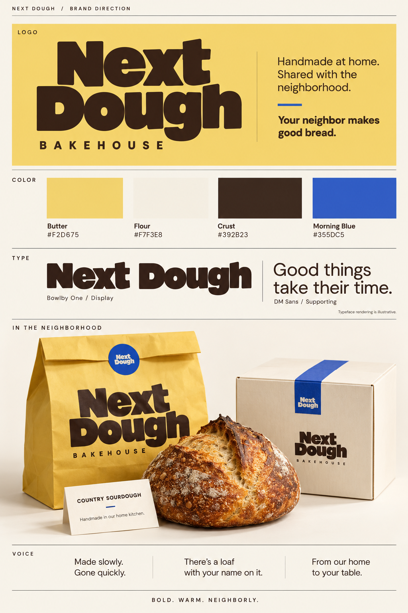
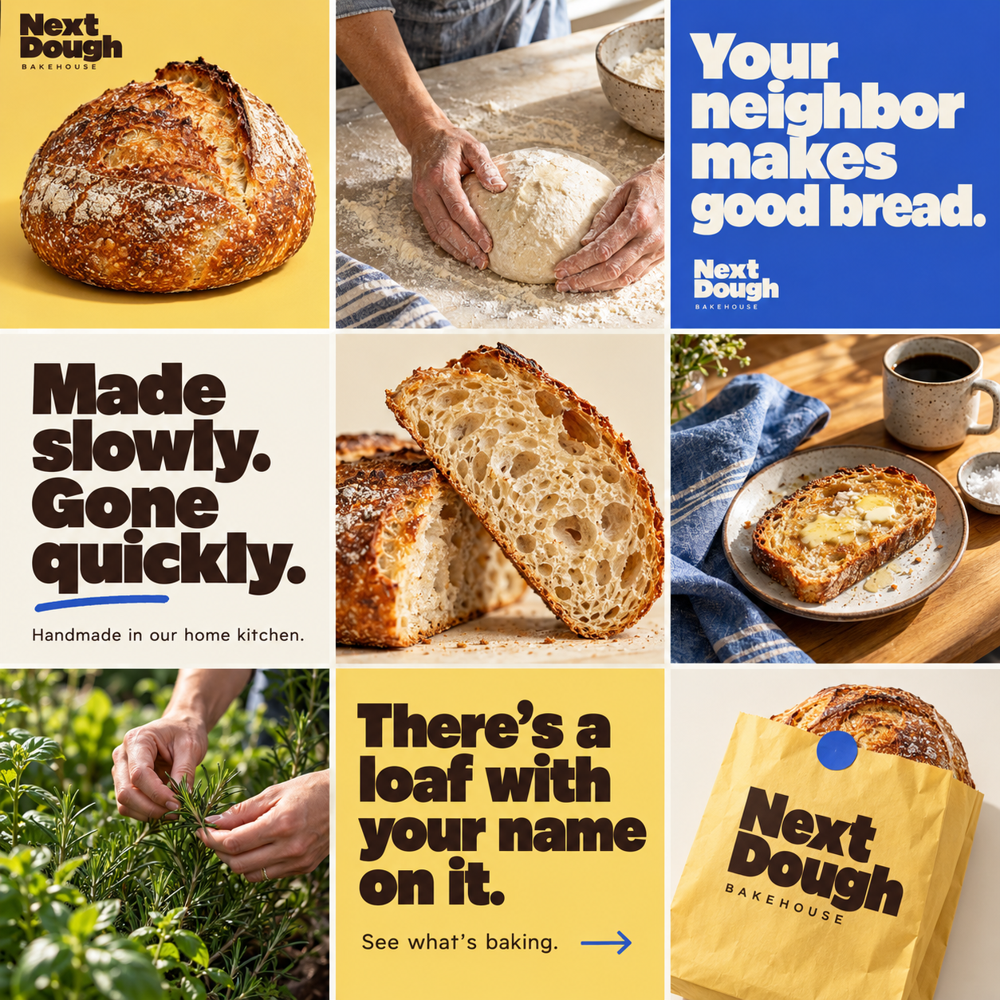

# Next Dough Bakehouse

Website for Next Dough Bakehouse: slow-made sourdough, handmade by Carly in her home kitchen.

## Brand
The full brand direction lives in [`brand/brand-board.png`](brand/brand-board.png).

| Colour | Hex |
|---|---|
| Butter | `#F2D675` |
| Flour | `#F7F3E8` |
| Crust | `#392B23` |
| Morning Blue | `#355DC5` |

- **Type:** Bowlby One (display) and DM Sans (supporting).
- **Logo:** `assets/logo.webp` (Crust, for light backgrounds) and `assets/logo-flour.webp` (Flour, for dark backgrounds).
- **Voice:** Bold. Warm. Neighborly. "Made slowly. Gone quickly." "There's a loaf with your name on it." "From our home to your table."

### Marketing assets
- **Ad backgrounds** (`brand/ads/`), loaf on Butter with open space for copy:
  - `ad-background-landscape.png` (1730×909, web banners)
  - `ad-background-square.png` (1254×1254, feed posts)
  - `ad-background-story.png` (940×1672, stories and reels)
- **Instagram grid** (`brand/social/instagram-grid.png`), the planned 3×3 launch grid.

### Social posts
Six ready-to-post images in `brand/social/posts/`, built on the three ad backgrounds:

| File | Size | Copy |
|---|---|---|
| `square-made-slowly.png` | 1080×1080 | Made slowly. Gone quickly. |
| `square-good-things.png` | 1080×1080 | Good things take their time. |
| `story-loaf-with-your-name.png` | 1080×1920 | There's a loaf with your name on it. |
| `story-home-to-table.png` | 1080×1920 | From our home to your table. |
| `landscape-your-neighbor.png` | 1200×630 | Your neighbor makes good bread. |
| `landscape-made-slowly.png` | 1200×630 | Made slowly. Gone quickly. |

To edit the copy or add posts, change `brand/social/source/make-posts.js` and run `node make-posts.js` from that folder (needs Playwright).

## Pages
- `index.html`: homepage. The hero loaf turns left-to-right like a 3D model as you scroll. Also has the menu ("Our bakes"), how ordering works, Carly's animated line portrait, and a "Say hello" order form that opens a pre-filled email.
- `about.html`: "Our kitchen". Meet Carly, plus the animated family line drawing in "Everyone helps".

## Files
- `styles.css`, `script.js`: shared styles and behaviour (scroll turntable, line-drawing animations, reveal animations, order form).
- `assets/loaf-3d.js`: unwrapped crust texture and loaf profile used by the turntable (embedded so it also works when opened straight from disk).
- `assets/sourdough-loaf.webp`: still loaf image (no-JS fallback).
- `assets/carly-lines.webp`, `assets/family-lines.webp`: line drawings (the animated strokes are inline SVG in the pages).
- `assets/carly.jpg`: Carly's photo on the "Our kitchen" page.
- `brand/brand-board.png`: brand board.
- `brand/ads/`, `brand/social/`: ad backgrounds and the Instagram grid.

## Run it
Open `index.html` in a browser. No build step. Any static host works (GitHub Pages, Netlify, Vercel).

## Before launch
Confirm the order/pickup times and the `hello@nextdough.com` email (also set in `data-email` on the order form).
